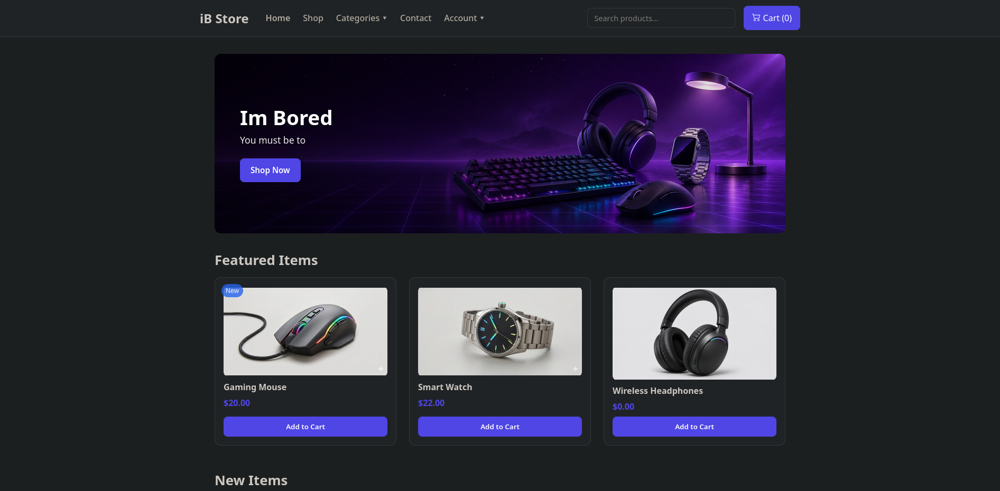
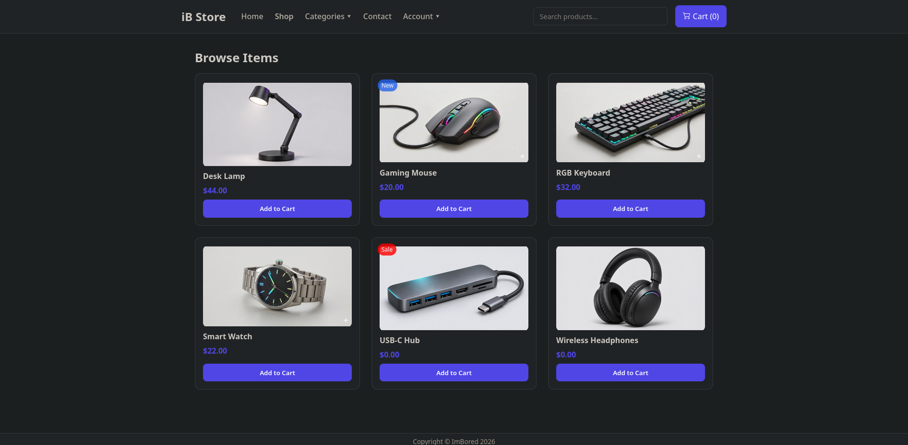
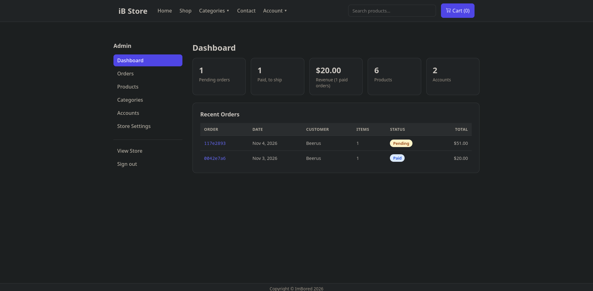
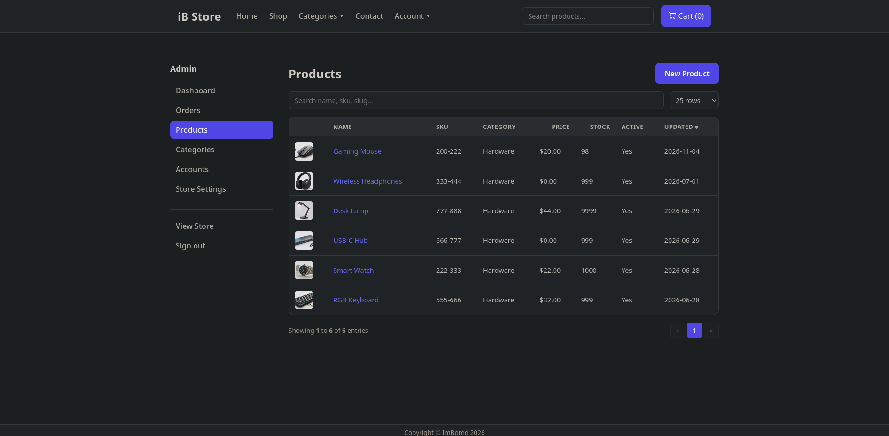
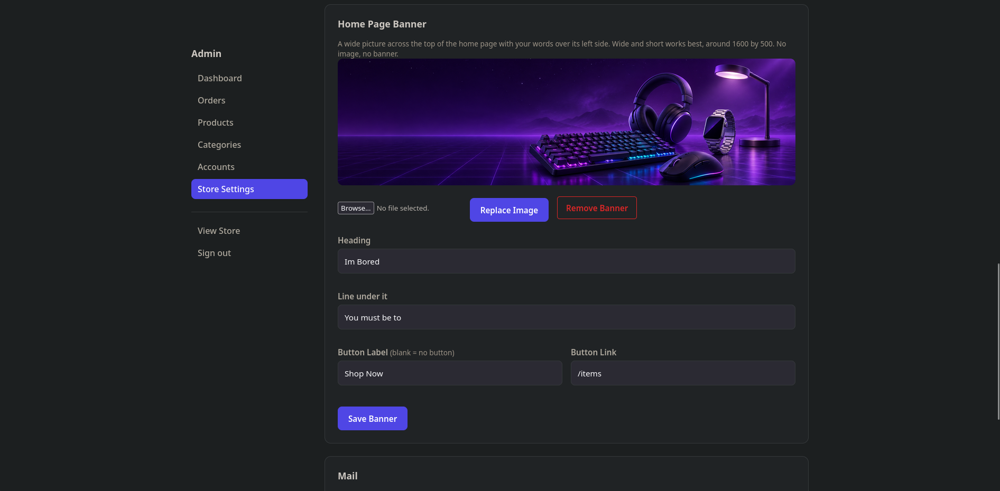

# iB Store

A small self hosted store front in PHP. Physical and digital products, cart, checkout, customer accounts, order emails, an admin panel, and three payment options: Bitcoin through your own BTCPay Server, cards through Stripe Checkout, and PayPal. Built on [Flight PHP](https://flightphp.com/) with a matching [FlightJS](https://github.com/fswolf/flightjs) front end on a plain LAMP stack plus Redis. No Composer, no bundler, no framework bloat. Clone it, point Apache at `public_html`, import the database and you have a store.





## Fast

All the structure of a modern framework, all the weight of a 2008 one. Routes, controllers, models, CSRF, argon2id, rate limiting, signed webhooks, atomic order state, in about 19 kB of code.

This is not a first attempt at the pattern. The same Flight PHP plus FlightJS shape runs in about ten live projects across different fields, and it is what fifteen years of building on traditional LAMP stacks settled into: the parts that kept earning their place stayed, the rest got left out. The store is the current distilled form of it.

PHP serves the page shell, FlightJS fills in the content through the json api, and that is the whole stack: no bundle, no build, no hydration pass. The JS is a handful of small ES modules the router loads for the page you are on, nothing else comes down. On the PHP side the class map is cached so there is no directory scanning per request, and the rate limiter sits in Redis. Measured on the home page with the demo products, nothing special on the server side:

| | Requests | Transferred | Finished |
|---|---|---|---|
| Cold load | 17 | 156 kB | 135 ms |
| Cached | 17 | 6 kB | 108 ms |

The code itself is about 19 kB over the wire. The rest of the cold load is the product images (webp, about 30 kB each).

## What is in the box

- **Catalogue** with categories, product images, stock, badges (new, featured, sale) and search
- **Cart and checkout** with flat shipping, free shipping over an amount, and a tax percent, all set from the admin panel
- **Digital products** that skip shipping and hand out download links, keys (itch.io, Steam) or both once the order is paid
- **Accounts** with argon2id passwords, password reset by email, saved billing and shipping addresses, and an order history
- **Order emails** on checkout and on every status change (paid, shipped, complete, cancelled, refunded), through the server's own `mail()`
- **Admin panel** for orders, products, categories, accounts and store settings, with a test email button
- **Hero banner** on the home page, image plus heading, line and button, all set from the admin panel. Leave the image empty and it is not there
- **Tab icon** uploaded from the same settings page, with the bored face as the default
- **Payments** behind one small interface, so each gateway is a single class. Switch any of them on by filling in its keys in the config, leave them empty and the option stays off the payment page. One with keys can also be switched off from Store Settings without touching the keys

## Requirements

- Apache with `mod_rewrite` (the `.htaccess` is in `public_html`), or anything else that can send every request to `index.php`
- PHP 8.1 or newer with `pdo_mysql`, `mbstring`, `curl`, `json` and `fileinfo`. Bitcoin also needs `bcmath`
- MariaDB or MySQL
- A working `mail()` on the server for the order emails (optional, the store runs without it, see [Mail](#mail) below)
- Redis on localhost and the php redis extension. The rate limiter (`REQUEST_LIMIT` per minute per ip in the config) runs on Redis and only falls back to files in `cache/req/` when the extension is missing, so install it for full functionality

## Install

1. Clone the repo and point your web root at `public_html`.
2. Create a database and import `ib_store.sql`. It has the tables, a demo category with a few products, and one store settings row.
3. Copy `public_html/config/config.example.php` to `config.php` and fill in the `DB_*` lines and `MAIL_FROM`. That file is ignored by git, so your keys never leave the server.
4. Make `public_html/cache/` and `public_html/assets/images/items/` writable by the web server user. The first holds the class map and rate limit files, the second is where product uploads land.
5. Register an account, then set `is_admin = 1` on it in the `accounts` table and open `/admin`. Store Settings is the first stop: currency, tax, shipping and your contact details.
6. For Bitcoin, run `./update-libs.sh` once. It pulls the official BTCPay Greenfield client into `public_html/assets/vendor/`.

Everything after that is in [docs/README.md](docs/README.md): how the code hangs together, the flow of a sale, and the step by step for each payment gateway (what to create on the BTCPay, Stripe and PayPal side, which webhook events, where the ids go).

## Try it locally

No Apache, Redis or mail needed to look around, just PHP 8.1+ (with `pdo_mysql`, `mbstring`, `curl`, `fileinfo`) and MariaDB or MySQL. From a fresh clone:

```bash
git clone https://github.com/fswolf/ib-store && cd ib-store

# a database and a user for it, then the tables and the demo catalogue
sudo mariadb -e "CREATE DATABASE ib_store; CREATE USER 'ib_store'@'localhost' IDENTIFIED BY 'ib_store'; GRANT ALL ON ib_store.* TO 'ib_store'@'localhost';"
mariadb -u ib_store -pib_store ib_store < ib_store.sql

# config pointing at it
cp public_html/config/config.example.php public_html/config/config.php
sed -i "s/'DB_USER', ''/'DB_USER', 'ib_store'/; s/'DB_PASSWORD', ''/'DB_PASSWORD', 'ib_store'/; s#https://store.example.com#http://127.0.0.1:8085#" public_html/config/config.php

# php's built in server, with a router that does what the .htaccess does
cat > router.php <<'PHP'
<?php
$path = parse_url($_SERVER['REQUEST_URI'], PHP_URL_PATH);
if ($path !== '/' && is_file(__DIR__ . '/public_html' . $path)) return false;
$_SERVER['DOCUMENT_ROOT'] = __DIR__ . '/public_html';
$_SERVER['SCRIPT_NAME'] = '/index.php'; // php -S sets this to the request path, which makes Flight think the first segment is a base dir
$_SERVER['PHP_SELF'] = '/index.php';
chdir(__DIR__ . '/public_html');
require __DIR__ . '/public_html/index.php';
PHP
php -S 127.0.0.1:8085 -t public_html router.php
```

Open http://127.0.0.1:8085, register an account, then make it the admin and open `/admin`:

```bash
mariadb -u ib_store -pib_store ib_store -e "UPDATE accounts SET is_admin = 1 WHERE email = 'you@example.com';"
```

`router.php` is in `.gitignore`, so it never ends up on a live server. Payments stay off until you fill in a gateway's keys in `config.php`.

## Mail

The store sends through php `mail()`, which hands each message to the server's MTA. Whether it reaches an inbox is down to how that MTA sends, not the store, so sort it out before you sell anything: an order email is the customer's receipt, and a missing one turns into a chargeback instead of an email to you.

- **Send through a relay, not straight off the box.** Most hosts block outbound port 25, and mail sent directly from a VPS or home IP is judged on that address range's reputation. Point the MTA at an authenticated SMTP relay instead: your mail provider's SMTP, or a service like Amazon SES, Mailgun or Postmark. With postfix that is `relayhost` plus SASL auth, with msmtp it is a few lines in `/etc/msmtprc` and `sendmail_path` in php.ini pointing at it.
- **Send as your own domain.** `MAIL_FROM` should be an address on the store's domain, and that domain needs SPF and DKIM for the relay plus a DMARC record. The relay's setup page gives you the DNS records.
- **Set the bounce address.** The store does not pass an envelope sender to `mail()`, so bounces go wherever the MTA says. Set it to an address you read (`from` in msmtprc, or `-f you@yourdomain` on `sendmail_path`), otherwise a receipt that never arrived is invisible.
- **Test it for real.** Use the test email button in Store Settings, then put an order through and check where both land in a Gmail account, inbox or spam.

## Payments in one paragraph

Checkout writes a `pending` order and sends the customer to `/cart/payment/<order>`, which shows a button for every gateway that is switched on. The button creates the invoice on the gateway's side and sends the customer there. When they pay, the gateway's webhook flips the order to `paid` and the emails go out. When they come back to the payment page the store also asks the gateway directly, so a lost webhook never strands an order. Card numbers never touch your server, Stripe and PayPal host their own pages, and Bitcoin goes straight to the wallet connected to your BTCPay Server.

## Admin



Orders with a status filter and private notes, products with image upload, categories, accounts, and the store settings that drive checkout. Cancelling a pending order puts the stock back.



The home page banner is set from the same place: upload a picture, type the heading, line and button, save.



## Layout

    public_html/
      index.php, routes.php, autoloader.php   every url to a controller, classes found without composer
      controllers/      page controllers render views, controllers/api/ answer json
      models/           one class per table
      libraries/        cart, mail, sessions, database, and PaymentLibrary with the three gateways under it
      views/            php templates, shared pieces in views/include/
      assets/js/        FlightJS: routes.js maps a url to a page class in pages/
      assets/vendor/    third party code, picked up by the same autoloader
      flight/           the Flight PHP framework
      config/           config.example.php, errors.php, security.php
    docs/               the longer read, and the screenshots
    ib_store.sql        the database

## Adding a payment gateway

One class in `libraries/` extending `PaymentLibrary` with `enabled()`, `start()`, `check()` and `webhook()`, one line in `PaymentLibrary::all()`, a block of defines in `config.php` and an icon in `views/cart/payment.html`. The controller, the payment page and the emails do not need to know it exists.

## License

iB Store is licensed under the [MIT License](LICENSE). Copyright © 2026 fswolf.
